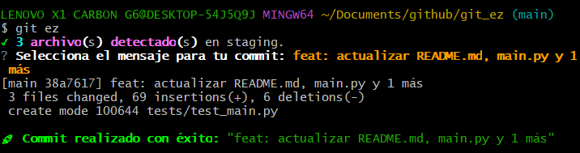

# GitEz 🚀

> **Un generador interactivo, ultrarrápido y local de mensajes para commits en Git — en español.**

`GitEz` analiza los archivos que agregaste a *staging* (`git add .`) y te sugiere automáticamente mensajes estandarizados bajo la convención de **Conventional Commits**, **redactados en español**. Se ejecuta en milisegundos, funciona 100% offline y no requiere API keys.

---

## 📸 Demo en funcionamiento

Mira cómo `GitEz` detecta automáticamente los archivos en staging, sugiere el mensaje adecuado y realiza el commit con un solo `Enter`:



---

## ⚡ Características

- 🚀 **Ultra rápido:** Latencia prácticamente nula, sin dependencias de servicios externos ni LLMs de pago.
- 🔒 **100% Privado:** Todo el análisis se ejecuta de forma local en tu máquina.
- 🇪🇸 **Mensajes en español:** Todas las sugerencias de commit se generan en español de forma nativa.
- 🎯 **Sugerencias inteligentes:** Detecta extensiones de archivos, documentación, tests y configuraciones para inferir el tipo de commit (`feat`, `fix`, `docs`, `test`, `chore`).
- 🏷️ **Integración con tickets:** Infiere automáticamente el ID de Jira o ticket a partir del nombre de tu rama Git.
- ⌨️ **Interfaz TUI fluida:** Selecciona el mensaje de forma sencilla utilizando las flechas del teclado.

---

## 🇪🇸 Commits en español

`GitEz` genera los mensajes de commit **en español** por defecto. Algunos ejemplos de las sugerencias que verás:

| Tipo | Ejemplo de mensaje generado |
|------|----------------------------|
| `feat` | `feat: actualizar main.py, utils.py` |
| `fix` | `fix: resolver problema en auth.py` |
| `docs` | `docs: actualizar documentación (README.md)` |
| `test` | `test: agregar o actualizar pruebas unitarias` |
| `chore` | `chore: actualizar dependencias y configuración del proyecto` |

Si tu rama tiene un ticket de Jira (ej. `feature/PROJ-42-login`), se incluye automáticamente:

```
feat: [PROJ-42] actualizar main.py, utils.py
```

---

## 🖥️ Requisitos

- Python **3.10** o superior
- [`pipx`](https://pipx.pypa.io/stable/) (recomendado) o `pip`
- Git instalado y disponible en el `PATH`

---

## 📦 Instalación

La forma recomendada de instalarlo para que quede disponible como comando global en tu terminal es mediante `pipx`:

```bash
pipx install git+https://github.com/AAMoralesC/GitEz.git
```

### Instalación manual / Desarrollo local

Si prefieres clonar el repositorio e instalarlo directamente:

```bash
git clone https://github.com/AAMoralesC/GitEz.git
cd GitEz
pipx install .
```

Si prefieres usar `pip` convencional (asegúrate de que tu entorno lo permita):

```bash
pip install git+https://github.com/AAMoralesC/GitEz.git
```

### Actualización

Si ya tienes `GitEz` instalado y quieres actualizarlo a la última versión:

```bash
pipx upgrade git-ez
```

> **Nota:** Si `pipx` muestra una advertencia de que el ejecutable en `.local\bin` no coincide, elimínalo manualmente y reinstala:
> ```bash
> # Windows (PowerShell)
> Remove-Item "$env:USERPROFILE\.local\bin\git-ez.exe" -Force
> pipx reinstall git-ez
> ```

---

## 💻 Uso

1. Realiza cambios en tu repositorio y agrégalos al área de preparación (*staging*) como de costumbre:
   ```bash
   git add <archivo>
   # o bien: git add .
   ```

2. Ejecuta el comando desde cualquier consola (Git Bash, PowerShell, CMD):
   ```bash
   git ez
   ```
   *(También puedes llamarlo como `git-ez` o `gitez` dependiendo de tu entorno)*

3. Usa las flechas `↑`/`↓` para navegar entre las sugerencias o elige la opción para escribir un mensaje personalizado. Presiona `Enter` y el commit se ejecutará automáticamente.

---

## 🛠️ Tecnologías utilizadas

- **Python**
- [Typer](https://typer.tiangolo.com/) — Construcción de la CLI
- [Questionary](https://questionary.readthedocs.io/) — Menús interactivos en la terminal
- [Rich](https://rich.readthedocs.io/) — Formatos y estilos en la consola

---

## 🤝 Contribuciones

¡Las contribuciones son bienvenidas! Si deseas mejorar el proyecto:
1. Haz un Fork del repositorio.
2. Crea tu rama para la nueva funcionalidad (`git checkout -b feature/AmazingFeature`).
3. Agrega tus cambios al área de staging (`git add .`).
4. Haz commit usando nuestra propia herramienta (`git ez` 😉).
5. Sube tu rama (`git push origin feature/AmazingFeature`).
6. Abre un Pull Request.

---

## 📄 Licencia

Este proyecto está distribuido bajo la **Licencia MIT**. Consulta el archivo `LICENSE` para más información.
